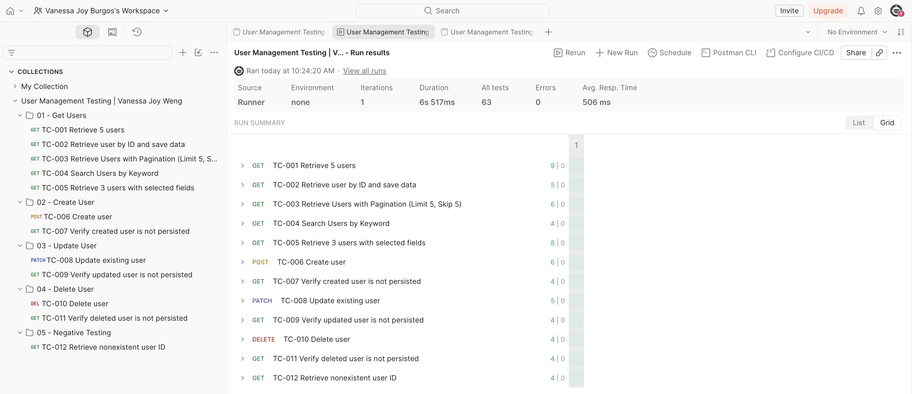

# User Management API Testing Portfolio

[](https://github.com/vanieb/user-management-api-testing/actions/workflows/newman.yml)

A Postman-based API testing portfolio project by **Vanessa Joy Weng** demonstrating functional and negative testing of the public [DummyJSON Users API](https://dummyjson.com/docs/users).

The project includes **12 test cases with 63 automated assertions**, covering CRUD operations, pagination, search, field selection, response validation, collection variables, and simulated data persistence behavior.

## Project Scope

| Folder | Test Cases | Focus |
|---|---|---|
| 01 - Get Users | TC-001–TC-005 | Retrieval, pagination, search, field selection |
| 02 - Create User | TC-006–TC-007 | Simulated creation and non-persistence |
| 03 - Update User | TC-008–TC-009 | Simulated partial update and non-persistence |
| 04 - Delete User | TC-010–TC-011 | Simulated deletion and subsequent retrieval |
| 05 - Negative Testing | TC-012 | 404 handling for nonexistent users |

## Tools and Techniques

- Postman for API request execution and automated validation
- Newman for command-line collection execution
- GitHub Actions for continuous integration
- JavaScript assertions using `pm.test` and `pm.expect`
- HTTP methods: GET, POST, PATCH, DELETE
- HTTP status code, response structure, field, and data type validation
- Pagination, search, and request/response consistency checks
- Collection variables for dynamic data handling and cross-request validation
- Positive and negative testing, including simulated CRUD non-persistence verification

## Setup and Execution

### Using Postman

1. Import `user-management.postman_collection.json` into Postman.
2. Set the collection variable `baseUrl` to `https://dummyjson.com`.
3. No authentication is required.
4. Run all 12 requests **in collection order**, using one iteration in Collection Runner.

### Using Newman

Install Newman:

```bash
npm install -g newman
```

Execute the collection:

```bash
newman run "user-management.postman_collection.json"
```

Generate a JUnit XML report:

```bash
mkdir -p reports

newman run "user-management.postman_collection.json" \
  --reporters cli,junit \
  --reporter-junit-export reports/newman-results.xml
```

**Dependencies:** TC-002 provides baseline names for TC-008 and TC-009. TC-006 provides `simulatedUserId` for TC-007. Run TC-010 before TC-011 using the same user ID.

**API limitation:** DummyJSON simulates create, update, and delete responses without permanently modifying its user database. The follow-up tests verify this documented behavior.

## Continuous Integration

This project uses **GitHub Actions and Newman** to execute the Postman API test collection automatically.

The CI workflow includes:

- Automated execution on pushes and pull requests
- Manual execution through GitHub Actions
- Newman collection execution and assertion validation
- JUnit XML test report generation
- Downloadable test results through GitHub Actions artifacts

**CI Execution Status: PASS**

The documented Newman execution completed successfully with 12 requests and 63 passing assertions.

[View GitHub Actions Workflow](https://github.com/vanieb/user-management-api-testing/actions)

## Documentation

For detailed test case descriptions, expected results, validations, and dependencies, refer to the Overview and request descriptions in the Postman collection.

## Test Execution Results

### Postman Execution Evidence



### Newman Execution (GitHub Actions)

Newman test results are generated in JUnit XML format and made available as downloadable GitHub Actions artifacts.

### Summary

Both documented executions completed successfully with **12 API requests, 63 passing assertions, and zero failures**.

The test coverage includes user retrieval, pagination, search, field selection, simulated user creation, updates, deletion, non-persistence verification, and negative testing.

**Result: PASS — No assertion failures or execution errors were reported.**

## Reference

[DummyJSON Users API Documentation](https://dummyjson.com/docs/users)
